# 🦷 SecDent AI — Mobile App

Flutter mobile app for **SecDent AI**, a dental clinic management system. Doctors and clinic staff use it to manage appointments, patient records, dental charts, X-rays, emergency cases and lab requests, backed by a Node.js / Express / MySQL REST API.

> Backend repository: [SecDentAI-Backend](https://github.com/MunzerGh/SecDentAI-Backend)

## Screenshots

<table>
<tr><td align="center">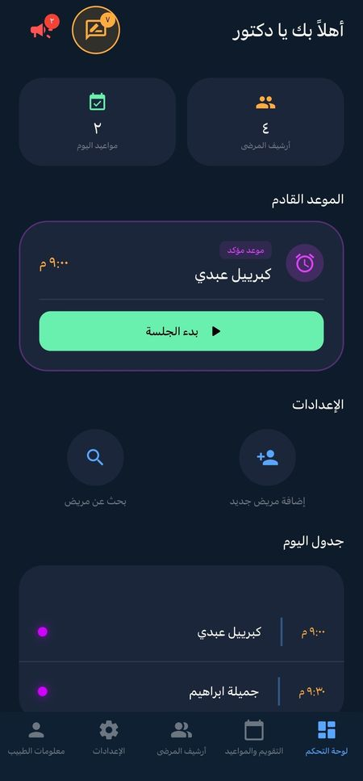</td><td align="center">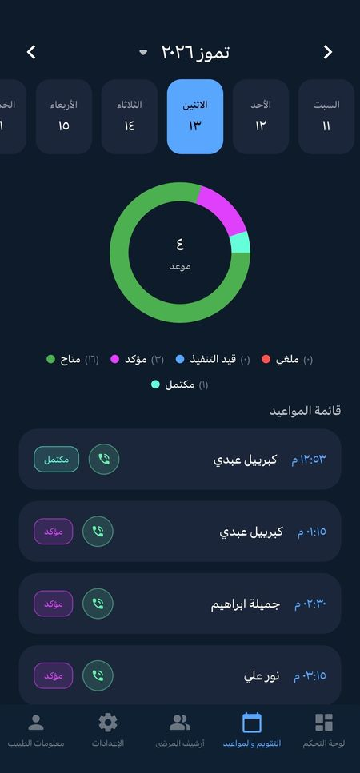</td><td align="center">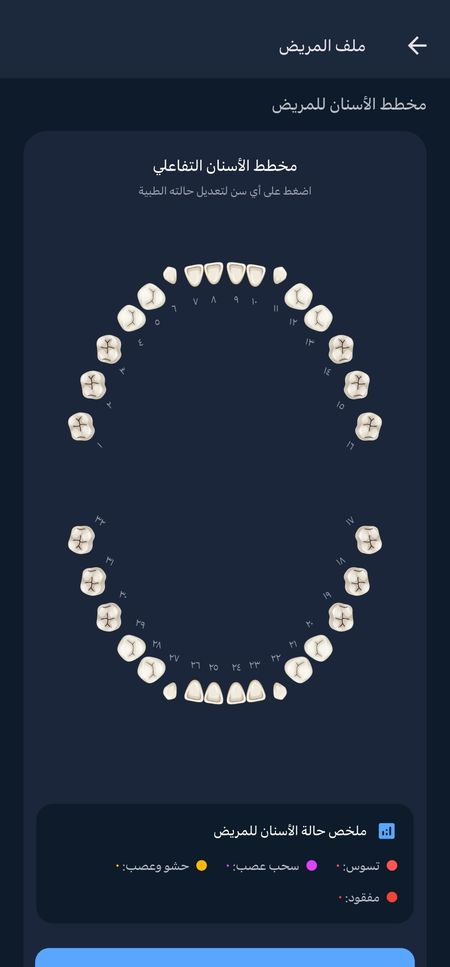</td><td align="center">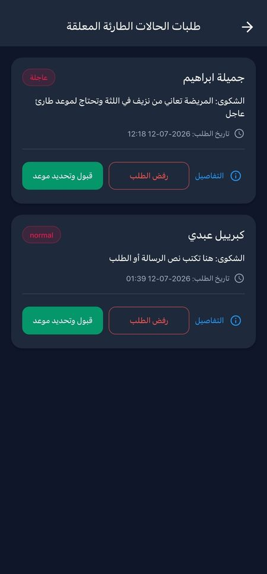</td></tr>
<tr><td align="center"><sub>Dashboard</sub></td><td align="center"><sub>Appointment calendar</sub></td><td align="center"><sub>Dental chart</sub></td><td align="center"><sub>Emergency requests</sub></td></tr>
<tr><td align="center">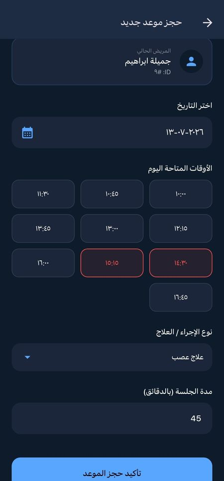</td><td align="center">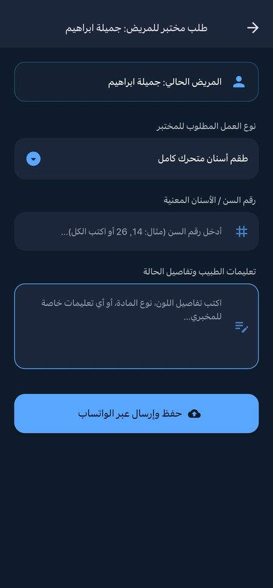</td><td align="center">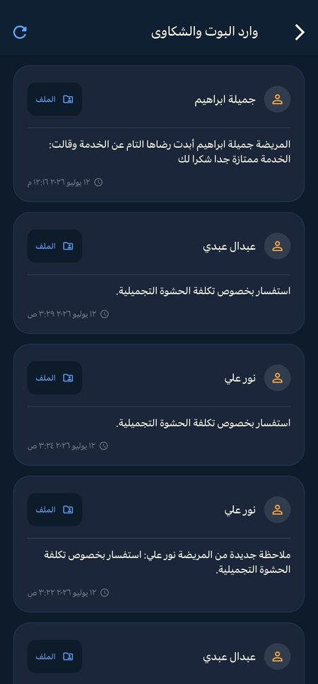</td><td align="center">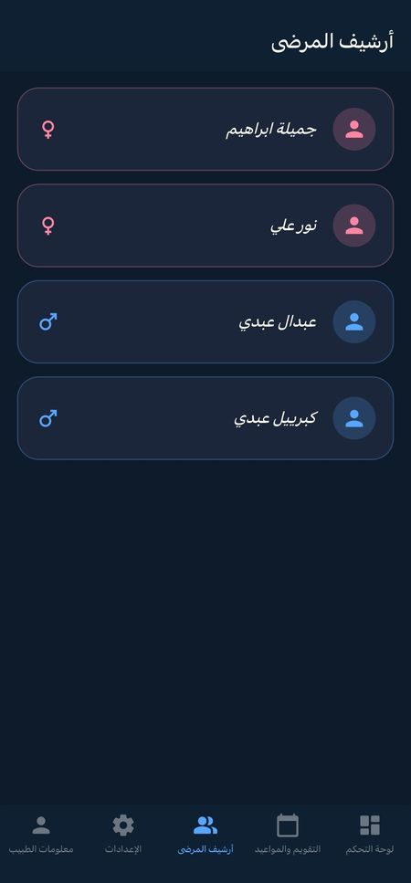</td></tr>
<tr><td align="center"><sub>Book appointment</sub></td><td align="center"><sub>Lab request</sub></td><td align="center"><sub>Bot and complaints inbox</sub></td><td align="center"><sub>Patient archive</sub></td></tr>
<tr><td align="center">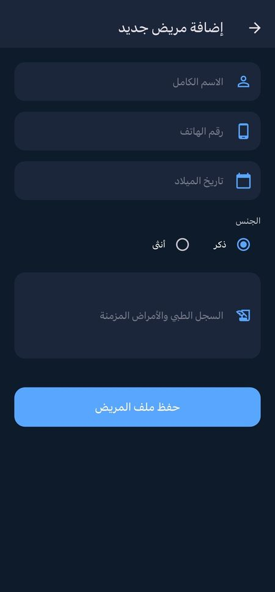</td><td align="center">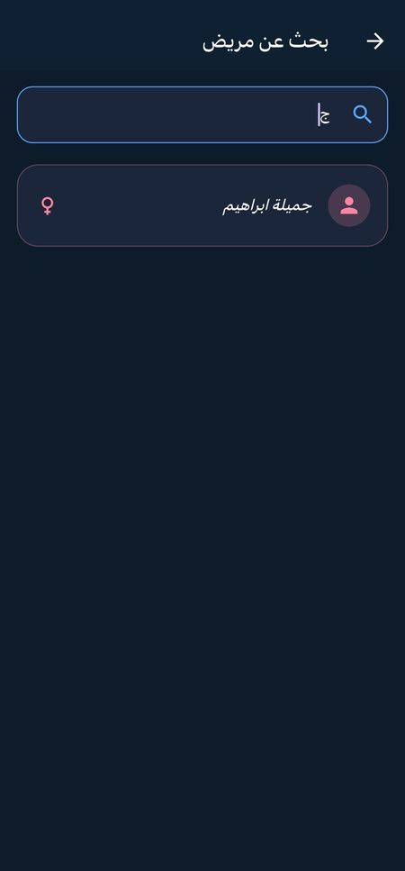</td><td align="center">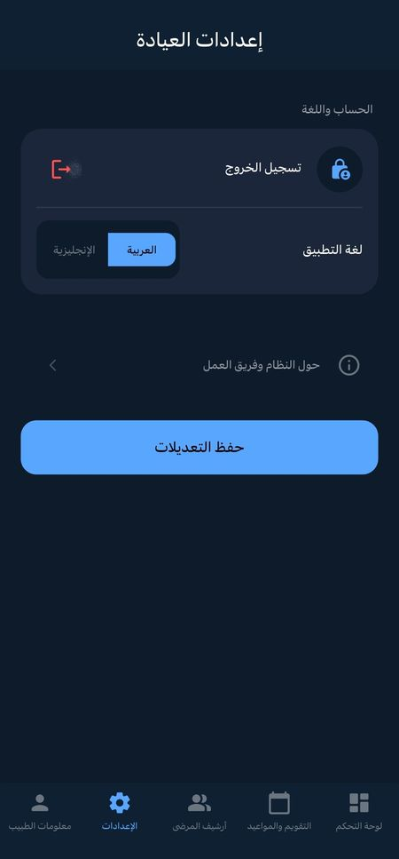</td><td align="center">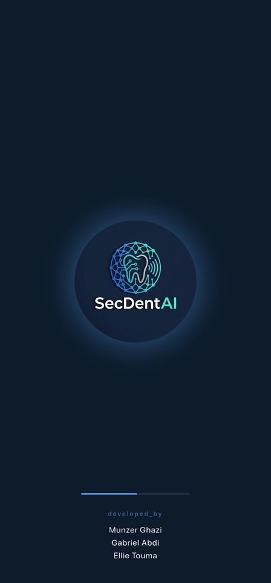</td></tr>
<tr><td align="center"><sub>Add patient</sub></td><td align="center"><sub>Patient search</sub></td><td align="center"><sub>Settings and language</sub></td><td align="center"><sub>Splash screen</sub></td></tr>
</table>

## Features

- **Dashboard** with daily clinic statistics and the next appointment.
- **Appointment calendar** with a date timeline, booked-slot checking and status updates.
- **Patient management:** add patients, search, archive, and a full patient profile.
- **Dental chart:** per-tooth records that can be viewed and saved for each patient.
- **X-ray viewer:** browse each patient's radiographs.
- **Emergency cases:** review incoming cases, then accept and schedule or reject them, with a local notification and one-tap call.
- **Lab requests:** create a request and send it through WhatsApp.
- **Patient feedback** screen and **doctor profile** with photo upload.
- **Arabic and English** interface (Arabic by default).

## Tech stack

| Area | Packages |
|---|---|
| Framework | Flutter, Dart (SDK `>=3.0.0 <4.0.0`) |
| State management, routing, localization | [GetX](https://pub.dev/packages/get) |
| Networking | [http](https://pub.dev/packages/http) |
| Charts and calendar | `fl_chart`, `easy_date_timeline` |
| Device features | `flutter_local_notifications`, `image_picker`, `url_launcher`, `shared_preferences` |
| UI | `flutter_svg`, `font_awesome_flutter`, `intl` |

## Project structure

```
lib/
├── main.dart               # App entry, theme, translations
├── api_config.dart         # Backend base URL and endpoints
├── app_translations.dart   # Arabic / English strings
├── core/                   # Colors and shared constants
├── models/                 # Data models (patient, appointment, doctor, ...)
├── controllers/            # GetX controllers (state + API calls)
├── views/screens/          # App screens
├── widgets/                # Reusable widgets
└── Services/               # Local notification service
```

The app follows a simple MVC-style layout: screens render state held by GetX controllers, and the controllers call the REST API.

## Getting started

**Requirements:** Flutter SDK (Dart 3), an Android/iOS device or emulator, and the [backend](https://github.com/MunzerGh/SecDentAI-Backend) running.

```bash
git clone https://github.com/MunzerGh/SecDent-AI--MobileApp.git
cd SecDent-AI--MobileApp
flutter pub get
```

Set the backend address in `lib/api_config.dart`:

```dart
static const String baseUrl = 'http://YOUR_BACKEND_IP:3000';
```

Use your computer's local network IP (not `localhost`) when testing on a physical device, then run:

```bash
flutter run
```

## Roadmap

- [ ] Send the JWT with every API request and store it securely
- [ ] Move the base URL to build-time configuration (flavors / `--dart-define`)
- [ ] Add unit tests for controllers and widget tests for key screens
- [ ] Add CI (analyze and test on every push)

## Author

**Munzer Ghazi** — Computer Engineering student, Flutter and Node.js developer
[GitHub](https://github.com/MunzerGh) · [LinkedIn](https://linkedin.com/in/munzer-ghazi)
